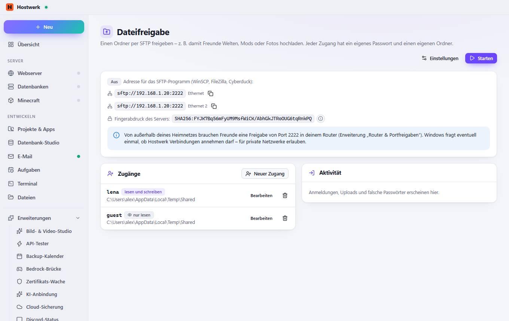

# Dateifreigabe (SFTP)

Einen Ordner per SFTP freigeben – z. B. damit Freunde Welten, Mods oder Fotos hochladen. Jeder Zugang mit eigenem Passwort und eigenem Ordner, auf Wunsch nur lesend; Sperre nach falschen Passwörtern und ein Protokoll aller Anmeldungen und Uploads.

[English](README.md) · Eine offizielle [Hostwerk](https://github.com/Passimoritz/hostwerk-public) Erweiterung (SDK 2.7, native Erweiterung)



## Was sie kann

- **Wo:** Dateien (Rechtsklick, Kennzeichen und Abschnitt zum geöffneten Ordner) – seit 1.3.1 ohne eigenen Seitenleisten-Eintrag; die ganze Seite bleibt unter Erweiterungen → Öffnen
- **„Ordner freigeben“ als geführter Ablauf:** Ordner → für wen (Zugang mit Passwort oder SSH-Schlüssel, Download-Link, Team-Mitglieder) → Rechte (nur lesen / lesen und schreiben) → Ablauf und Speichergrenze → fertig mit Adresse, QR-Code und „Kopieren“
- **Freigaben als ruhige Liste:** wer, welcher Ordner, Rechte, bis wann, zuletzt benutzt – Kopieren, QR-Code, Bearbeiten und Entfernen direkt dort (auch per Rechtsklick)
- **So verbinden sich andere** – kurze Schritte für Windows, macOS, Handy und FileZilla, Details hinter ⓘ; der Zustand des SFTP-Servers mit Start/Stopp oben
- **Im Datei-Browser von Hostwerk** (Hostwerk mit SDK 3.2): Rechtsklick auf einen Ordner → „Freigeben …“ startet den Ablauf mit diesem Ordner, freigegebene Ordner tragen ein kleines Zeichen mit „Freigegeben für …“, und der offene Ordner zeigt rechts seine Freigaben. Älteres Hostwerk: die Seite funktioniert für sich wie bisher
- SFTP-Server in Hostwerk – funktioniert mit WinSCP, FileZilla, Cyberduck und jeder Handy-App
- Zugänge mit eigenem Passwort (nur als scrypt-Hash gespeichert) und eigenem Ordner; niemand kommt darüber hinaus, Verknüpfungen nach draußen werden abgelehnt
- Nur-Lese-Zugänge zum Herunterladen
- **SSH-Schlüssel** je Zugang – Anmeldung ohne Passwort
- **Befristete Zugänge** (gültig bis zu einem Tag) und eine **Speichergrenze** je Zugang – praktisch für Gäste
- **Team-Mitglieder** (Erweiterung „Team & Benutzer“) melden sich mit ihrem Hostwerk-Passwort an und sehen je freigegebenem Dienst einen Ordner
- **Download-Links:** ein Ordner nur lesend im Browser, ohne SFTP-Programm – von außen über Hostwerks Fernzugriff; 1, 7, 30 Tage oder unbefristet
- **Port freigeben** mit einem Klick über die Erweiterung „Router & Portfreigaben“ – dort mit Herkunft „Dateifreigabe“, die Automatik behält sie, und ein neuer Port nimmt sie mit
- **Passwort-Tresor:** neue Zugänge landen auf Wunsch gleich im Tresor von „Passwörter“
- Adresse als **QR-Code** für SFTP-Apps auf dem Handy
- Sperre für 10 Minuten nach 5 falschen Passwörtern je Adresse; Passwortprüfungen bremsen Hostwerk nie (im Hintergrund, je Adresse eine nach der anderen); Protokoll
- Eigener Server-Schlüssel mit Fingerabdruck zum Abgleichen; Heimnetz oder nur dieser PC
- Andere Erweiterungen dürfen Reiter auf ihrer Seite ergänzen (`allowExtensions`)

## Installieren

In Hostwerk: **Erweiterungen → Entdecken** und „Installieren“ klicken.

Native Erweiterungen laufen als Teil von Hostwerk (eigener Server- und Oberflächen-Teil). Deshalb installiert Hostwerk sie nur aus dem offiziellen Katalog (mit Prüfsumme) oder im Entwickler-Modus.

## Daten

`data/file-share` – Einstellungen, Zugänge (nur Passwort-Hashes und öffentliche Schlüssel), Download-Links, Protokoll und der Server-Schlüssel. Beim Entfernen der Erweiterung bleibt das erhalten; die freigegebenen Ordner werden nie angefasst.

## Entwickeln

```bash
node --test tests/*.test.js          # Tests
node build-native.js .               # Oberfläche bauen (sdk/build-native.js aus hostwerk-public)
node check.js . --strict             # dieselbe Prüfung wie der Katalog (sdk/check.js)
```

Oberfläche in `ui/src`, Server-Teil in `server/`. Texte im Code sind Englisch, Deutsch steht in `locales/de.json`.

## Lizenz

MIT
