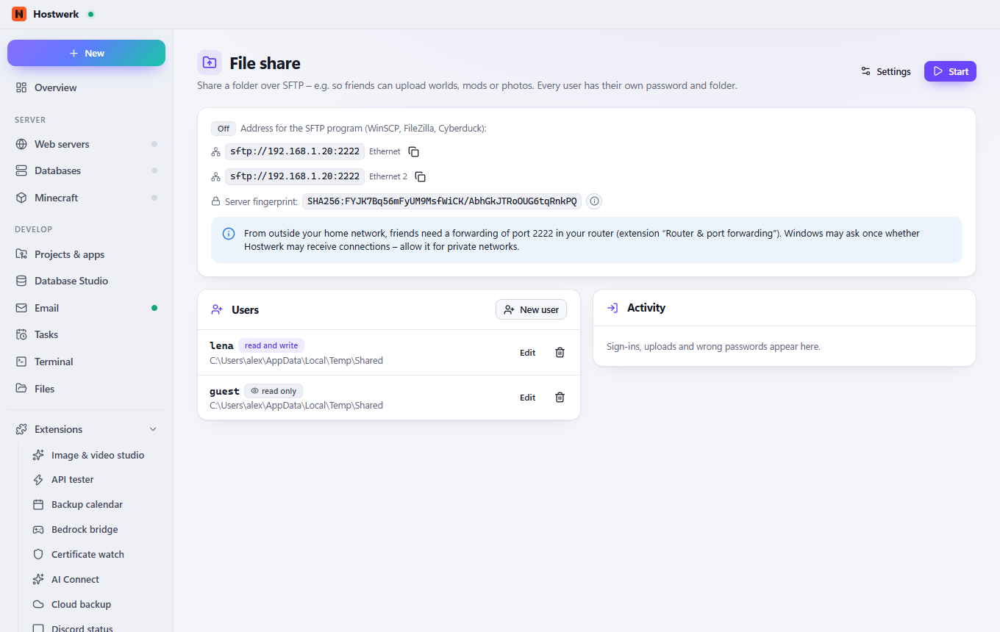

# File share (SFTP)

Share a folder over SFTP – e.g. so friends can upload worlds, mods or photos. Every user with their own password and folder, read-only if you like; lock-out after wrong passwords and a log of sign-ins and uploads.

[Deutsch](README.de.md) · An official [Hostwerk](https://github.com/Passimoritz/hostwerk-public) extension (SDK 2.7, native extension)



## What it does

- SFTP server built into Hostwerk – works with WinSCP, FileZilla, Cyberduck and every phone app
- Users with their own password (stored only as scrypt hash) and their own folder; nobody gets above it, links pointing outside are refused
- Read-only users for downloads
- Lock-out for 10 minutes after 5 wrong passwords per address; activity log
- Own server key with fingerprint to compare; home network only or this PC only

## Install

In Hostwerk: **Extensions → Discover** and click “Install”.

Native extensions run as part of Hostwerk (own server and interface part). That is why Hostwerk only installs them from the official catalogue (with checksum) or in developer mode.

## Data

`data/file-share` – settings, users (password hashes only), activity and the server key. Removing the extension keeps them; the shared folders are never touched.

## Develop

```bash
node --test tests/*.test.js          # tests
node build-native.js .               # build the interface (sdk/build-native.js from hostwerk-public)
node check.js . --strict             # same check as the catalogue (sdk/check.js)
```

Interface source in `ui/src`, server part in `server/`. Texts in the code are English, German is in `locales/de.json`.

## License

MIT
